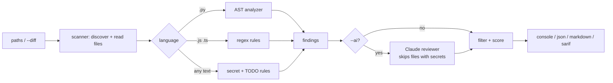

# codelens

[](https://github.com/thwxhx/codelens/actions/workflows/ci.yml)


**An AI-assisted code review CLI.** Fast deterministic analysis catches the bugs, vulnerabilities and leaked secrets a linter should catch. An optional Claude pass then reviews the files that need it most for the logic errors a linter can't see. Results come out as a rich terminal report, JSON, a Markdown PR comment, or SARIF for GitHub code scanning.

```
$ codelens review examples/vulnerable_app.py

examples/vulnerable_app.py
  15:12   CRITICAL SEC001 Possible AWS access key id committed to source (AKIA…)
           ↳ Revoke it, remove it from history, and load it from the environment.
  21:5    HIGH     PY009 SQL query built with string formatting is open to injection
           │ cur.execute(f"SELECT * FROM users WHERE id = {user_id}")
           ↳ Use parameterised queries: execute(sql, params).
  30:12   HIGH     PY004 eval() on dynamic input can execute arbitrary code
           │ return eval(fmt)
           ↳ Use ast.literal_eval for data, or a real parser for expressions.
  35:14   HIGH     PY006 yaml.load() can execute code embedded in untrusted data
           │ config = yaml.load(config_text)
           ↳ Use json, yaml.safe_load, or verify the data source.
  43:1    MEDIUM   PY013 `classify` nests control flow 6 levels deep (limit 4)
  ...

╭────────────────── codelens ───────────────────╮
│ 1 files · 55 lines · 18 findings              │
│ critical 1  high 8  medium 5  low 3  info 1   │
│ Health score: 0/100 (F)                       │
╰───────────────────────────────────────────────╯
```

## Features

- **AST-based Python analysis**: real parsing, not regexes. Cyclomatic complexity, nesting depth, mutable defaults, SQL/command injection, unsafe deserialization, disabled TLS verification, weak hashes, unused imports, and more.
- **Secret scanning** for any text file: AWS keys, GitHub tokens, provider API keys, private keys, and hard-coded credentials (entropy-checked to avoid placeholder noise). Secrets are **masked in every report**.
- **JavaScript / TypeScript heuristics**: `eval`, XSS sinks, `var`, loose equality, empty `catch`.
- **Optional LLM review (`--ai`)** with Claude: files are ranked by how much attention they need, line-numbered, and sent with the static findings so the model doesn't repeat them. Files containing a detected secret are **never** sent to the API.
- **PR-friendly**: `--diff origin/main` reviews only what changed. Markdown output for PR comments, SARIF for GitHub code scanning.
- **CI-native**: exit codes, `--fail-on`, a pre-commit hook, and ready-made GitHub Actions workflows.
- **Configurable**: `.codelens.toml` or `[tool.codelens]`, plus inline `# codelens: ignore[PY004]`.
- **Health score**: a 0-100 score and A-F grade, normalised per 100 lines so big repos aren't punished for being big.

## Install

```bash
pip install -e .            # core (only dependency: rich)
pip install -e ".[ai]"      # + Anthropic SDK for --ai
pip install -e ".[dev]"     # + pytest, ruff
```

Requires Python 3.11+.

## Usage

```bash
codelens review .                          # review the current directory
codelens review src/ app.py                # files and directories
codelens review . --fail-on medium         # exit 1 on medium or worse (default: high)
codelens review . --min-severity low       # hide info-level noise
codelens review . --ignore PY017 --ignore GEN001
codelens review . -f json                  # json | markdown | sarif | console
codelens review . -f sarif -o codelens.sarif
codelens review --diff origin/main         # only files changed since the merge-base
codelens rules                             # list every rule
```

Exit codes: `0` clean, `1` findings at or above `--fail-on`, `2` usage/config error.

### AI review

```bash
export ANTHROPIC_API_KEY=...
codelens review src/ --ai                  # Claude reviews the 8 files most in need
codelens review src/ --ai --ai-max-files 3 --model claude-sonnet-5-5
```

- The model is asked for a strict JSON list of `{line, severity, message, suggestion}`. Malformed replies are ignored, never crash the run.
- AI findings are marked `✦ AI` and capped at **high**; `critical` is reserved for deterministic detections.
- Without a key or the SDK, `--ai` prints a warning and the static review still runs.
- **Privacy:** `--ai` sends source files to the Anthropic API. Files with a detected secret are skipped. Leave `--ai` off to stay fully offline.

## GitHub Actions

- [`ci.yml`](.github/workflows/ci.yml): lint, tests on Python 3.11 to 3.13, and **codelens reviews its own source**.
- [`review.yml`](.github/workflows/review.yml): on every PR, reviews changed files (with `--ai` if `ANTHROPIC_API_KEY` is set), comments the Markdown report, uploads SARIF to code scanning, and fails on critical findings.

Pre-commit:

```yaml
repos:
  - repo: https://github.com/thwxhx/codelens
    rev: v0.1.0
    hooks:
      - id: codelens
```

## Configuration

`.codelens.toml` (or `[tool.codelens]` in `pyproject.toml`):

```toml
[codelens]
ignore = ["PY017", "GEN001"]
exclude = ["tests/*", "migrations/*"]
max_complexity = 10
max_function_lines = 60
max_params = 6
max_nesting = 4
fail_on = "high"          # or "none"
```

Suppress a finding inline:

```python
result = eval(trusted_expr)  # codelens: ignore[PY004]
result = eval(trusted_expr)  # codelens: ignore          (all rules on this line)
```

## Rules

| ID | Rule | Severity | Applies to |
|---|---|---|---|
| `PY000` | File could not be parsed. | high | python |
| `PY001` | Bare `except:` swallows KeyboardInterrupt. | medium | python |
| `PY002` | Exception handler does nothing. | medium | python |
| `PY003` | Mutable default argument is shared. | medium | python |
| `PY004` | eval()/exec() on dynamic input. | high | python |
| `PY005` | Command run through a shell. | high | python |
| `PY006` | pickle/marshal/yaml.load on data. | high | python |
| `PY007` | MD5/SHA-1 are broken for security use. | medium | python |
| `PY008` | verify=False disables TLS checks. | high | python |
| `PY009` | SQL built with string formatting. | high | python |
| `PY010` | Cyclomatic complexity over the limit. | medium | python |
| `PY011` | Function is longer than the limit. | low | python |
| `PY012` | Function takes too many parameters. | low | python |
| `PY013` | Control flow nested too deeply. | medium | python |
| `PY014` | tempfile.mktemp() is racy. | medium | python |
| `PY015` | Compare to None/True/False with `is`. | low | python |
| `PY016` | Imported name is never used. | low | python |
| `PY017` | Long public function has no docstring. | info | python |
| `JS001` | eval() or new Function(). | high | javascript |
| `JS002` | innerHTML / document.write sink. | medium | javascript |
| `JS003` | Prefer let/const over var. | low | javascript |
| `JS004` | Use === / !== instead of == / !=. | low | javascript |
| `JS005` | console.log left in code. | info | javascript |
| `JS006` | Empty catch block hides errors. | medium | javascript |
| `SEC001` | AWS access key id in source. | critical | any |
| `SEC002` | Private key material in source. | critical | any |
| `SEC003` | GitHub token in source. | critical | any |
| `SEC004` | Provider API key (sk-...) in source. | critical | any |
| `SEC005` | Hard-coded password/secret/token. | high | any |
| `GEN001` | TODO/FIXME/HACK marker. | info | any |
| `AI001` | Issue found by the LLM reviewer. | medium | any |

## How it works



```
src/codelens/
├── cli.py              argparse CLI, exit codes
├── scanner.py          file discovery, per-file dispatch
├── context.py          collects findings, handles inline suppressions
├── config.py           .codelens.toml / pyproject loading + validation
├── models.py           Severity, Finding, ScanResult (+ health score)
├── reporters.py        console, JSON, Markdown, SARIF 2.1.0
├── ai.py               Claude review: prompting, parsing, safeguards
├── git.py              changed-file detection for --diff
└── rules/
    ├── catalog.py      single source of truth for every rule
    ├── python_rules.py AST visitor (complexity, injection, ...)
    ├── js_rules.py     JS/TS heuristics
    └── generic_rules.py secrets (entropy-checked) + TODOs
```

Design notes:

- **Deterministic first, LLM second.** Static rules are fast, free and reproducible. The model only spends tokens on judgement calls, and sees the known findings so it won't repeat them.
- **The model is untrusted input's neighbour.** Source code is treated as data in the prompt, replies are parsed defensively, severities are clamped, and nothing the model says can fail a build above `high`.
- **Secrets never leak through the tool.** Reports show only a 4-character prefix, snippets are dropped for secret findings, and flagged files are withheld from the API.
- **It reviews itself.** CI runs `codelens review src --fail-on high` on every push. It caught real issues in its own code while being built.

## Development

```bash
pip install -e ".[dev]"
ruff check .
pytest --cov=codelens
codelens review src
```

## Roadmap

- [ ] Go and Rust rule packs
- [ ] Taint tracking for Python (source → sink across functions)
- [ ] Baseline file to adopt codelens on legacy code without fixing everything first
- [ ] Inline PR review comments (per-line) instead of a single summary comment
- [ ] `--fix` for mechanical rules (`== None`, unused imports)

## License

MIT
